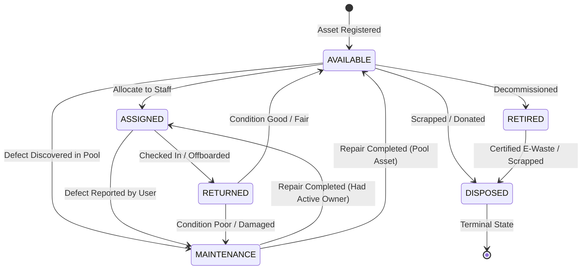
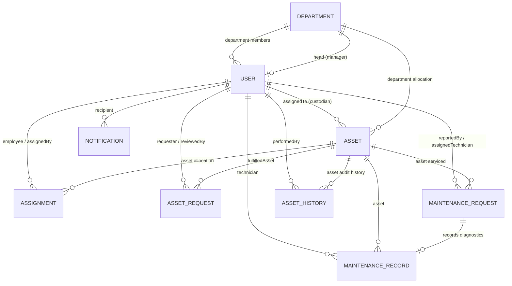

# IT Asset Management (ITAM) System — Enterprise MERN Platform

> **Comprehensive Enterprise Platform for Hardware Lifecycle Governance, Custody Tracking, Financial Straight-Line Depreciation, Preventive/Corrective Maintenance, and Automated Quality Assurance.**

---

## Table of Contents

1. [Executive Summary](#1-executive-summary)
2. [Single Source of Truth Directive](#2-single-source-of-truth-directive)
3. [Architecture Overview & Technology Stack](#3-architecture-overview--technology-stack)
4. [Zero-Dummy-Data & Self-Bootstrapping Engine](#4-zero-dummy-data--self-bootstrapping-engine)
5. [Role-Based Access Control (RBAC) Matrix](#5-role-based-access-control-rbac-matrix)
6. [Asset Lifecycle State Machine](#6-asset-lifecycle-state-machine)
7. [Financial Valuation & Straight-Line Depreciation Engine](#7-financial-valuation--straight-line-depreciation-engine)
8. [Database Schema & Data Models Specification](#8-database-schema--data-models-specification)
9. [Complete REST API Specification (~50 Endpoints)](#9-complete-rest-api-specification-50-endpoints)
10. [Frontend Architecture, UI/UX & Design System](#10-frontend-architecture-uiux--design-system)
11. [Automated Testing Framework (API & E2E)](#11-automated-testing-framework-api--e2e)
12. [Specialized Sub-Agent Protocols (`Lucy`, `Gabrille`, `Linda`)](#12-specialized-sub-agent-protocols-lucy-gabrille-linda)
13. [Installation, Environment Setup & Deployment Guide](#13-installation-environment-setup--deployment-guide)
14. [Project Directory & File Inventory](#14-project-directory--file-inventory)
15. [Security, Reliability & Best Practices](#15-security-reliability--best-practices)

---

## 1. Executive Summary

The **IT Asset Management (ITAM) Enterprise Platform** is a production-grade, full-stack web application designed for enterprise IT operations, hardware controllers, software asset managers, system administrators, and staff. It governs both physical IT assets (laptops, desktops, keyboards, mice, headsets, docking stations) and digital assets (software licenses, SaaS subscriptions, contracts/agreements, cloud resources, domain certificates) throughout their entire operational life—from procurement, single/multi-seat license allocation, and custody transfers, through maintenance diagnostics and straight-line depreciation or subscription amortization, to eventual retirement, contract expiration, and certified disposal.

### Core Objectives:
- **Unified Physical & Digital Governance**: Seamlessly govern hardware equipment alongside digital assets, multi-seat software licenses, SaaS subscriptions, and contract agreements in a unified asset repository.
- **Total Custody & Seat Allocation Visibility**: Track who possesses what equipment, view live allocated employee seat rosters on multi-seat licenses, track expected return dates, and monitor condition changes across all corporate departments.
- **Financial & Amortization Precision**: Continuously compute straight-line hardware depreciation and subscription contract term amortization in real time without manual spreadsheet calculations.
- **Maintenance Lifecycle**: Facilitate defect ticketing, bench triage, parts and labor cost tracking, and automatic operational state restoration.
- **Enterprise Security**: Role-based access guards (RBAC), JSON Web Token (JWT) stateless auth, NoSQL injection sanitization, security HTTP headers, and full audit ledgers.
- **Production QA**: Complete dual automated test suites powered by Newman (Postman API collection) and Puppeteer (browser end-to-end automation) with visual screenshot regression reports.

---

## 2. Single Source of Truth Directive

> [!IMPORTANT]
> **MANDATORY PROJECT-SPECIFIC BEHAVIOR FOR DEVELOPERS AND AI AGENTS**
> 
> This `README.md` document serves as the **authoritative single source of truth** for all project specifications, architecture contracts, database schemas, lifecycle transitions, API endpoints, and testing workflows across the entire codebase.
> 
> Whenever an assistant, developer, or specialized sub-agent (`Lucy`, `Gabrille`, `Linda`) needs to inspect, implement, modify, debug, or verify any feature, route, or model in this repository, they **MUST FIRST READ THIS README.MD** before proposing changes or executing code. Never guess or hallucinate API request bodies, query parameters, enum values, or database relations without consulting this specification.

---

## 3. Architecture Overview & Technology Stack

The platform is designed around a decoupled, three-tier MERN architecture with an automated testing harness:

```mermaid
flowchart TD
    subgraph Client Tier ["Client Tier (React 19 + Vite 8)"]
        UI["Tailwind CSS v4 + Lucide Icons + Recharts"]
        Context["AuthContext | ThemeContext | NotificationContext"]
        Axios["Axios Client (Bearer Interceptor & 401 Redirect)"]
        Router["React Router 7 (AppRouter & ProtectedRoute)"]
    end

    subgraph Server Tier ["Server Tier (Node.js + Express 4)"]
        Middleware["Helmet | CORS | Express-Mongo-Sanitize | Morgan"]
        AuthGuards["protect (JWT Verify) & authorize (Role Guard)"]
        Controllers["Modular Domain Controllers"]
        Services["Depreciation | History | Notification | Asset Rules"]
    end

    subgraph Data Tier ["Data Tier (MongoDB 8.9)"]
        MongoDb[(MongoDB Database / Atlas Cluster)]
        Mongoose["Mongoose ODM Schemas & Indexes"]
    end

    subgraph Testing Harness ["Automated QA Harness"]
        Newman["Newman CLI Runner (Postman Collection)"]
        Puppeteer["Puppeteer-Core Browser Automation (E2E Suite)"]
        Reports["JSON Reports & Screenshot Artifacts"]
    end

    Client Tier -->|REST API Calls JSON| Server Tier
    Server Tier -->|ODM Operations| Data Tier
    Testing Harness -->|HTTP API Verification| Server Tier
    Testing Harness -->|Headless Browser Interactions| Client Tier
```

### Technology Breakdown

| Component | Technology | Version | Purpose |
| :--- | :--- | :--- | :--- |
| **Frontend Framework** | React | `^19.2.8` | Component rendering, concurrent UI updates, and hooks |
| **Frontend Build Tool** | Vite | `^8.3.0` | High-speed ESM bundling, fast HMR, asset compilation |
| **Routing** | React Router DOM | `^7.18.4` | Declarative client routing, nested layouts, role guards |
| **Styling** | Tailwind CSS / PostCSS | `^4.3.3` | Utility-first CSS, dark mode theming, responsive grid |
| **Data Visualization** | Recharts | `^3.10.1` | Status donut charts, department density bars, valuation trends |
| **Iconography** | Lucide React | `^1.48.0` | Consistent enterprise icon set |
| **HTTP Client** | Axios | `^1.20.0` | Intercepted API calls, authorization header injection |
| **Backend Runtime** | Node.js (ESM) | `18+` / `20+` | Native ECMAScript Modules runtime |
| **REST API Framework**| Express.js | `^4.21.2` | Route handling, modular routers, centralized error middleware |
| **Database ODM** | Mongoose | `^8.9.5` | Strict schema validation, hooks, indexing, population |
| **Security & Headers**| Helmet, Express-Mongo-Sanitize | `^8.0.0` / `^2.2.0` | XSS, clickjacking prevention, NoSQL operator sanitization |
| **Authentication** | JSON Web Tokens (`jsonwebtoken`), bcryptjs | `^9.0.2` / `^2.4.3` | Stateless Bearer authentication, salted password hashing |
| **Request Validation**| Express-Validator | `^7.2.1` | Payload schema validation, error formatting |
| **API Testing** | Newman (Postman) | `^6.2.2` | CLI execution of 50-endpoint integration suite |
| **E2E Testing** | Puppeteer-Core | `^24.4.0` | Browser automation across 10 complete user journeys |

---

## 4. Zero-Dummy-Data & Self-Bootstrapping Engine

The platform operates on a strict **Zero Dummy Data Architecture**:
- **No Hardcoded Arrays**: All dashboard statistics, equipment counts, department headcounts, financial graphs, and notification streams are computed dynamically from real MongoDB documents.
- **Empty State UX**: Clean empty state placeholders with clear call-to-action buttons are presented whenever a collection or filter yields zero records.
- **Self-Bootstrapping Engine**:
  1. On system launch, the frontend queries `GET /api/auth/setup-status`.
  2. If `userCount === 0`, the application automatically displays the **System Initial Bootstrap Setup** interface.
  3. The user registers the initial **Master Administrator** account.
  4. Once provisioned, setup mode is permanently locked (`ALREADY_INITIALIZED` guard prevents duplicate bootstrap calls).
  5. The Master Administrator logs into the Admin Control Center to create departments, onboard staff, and register hardware assets.

---

## 5. Role-Based Access Control (RBAC) Matrix

The system enforces four distinct organizational roles with role-based route guards on both client and server:

1. **`ADMIN` (System Quorum / Organization Lead)**:
   - Full master permissions across users, departments, assets, requests, maintenance, reports, and system settings.
   - Can deactivate accounts, delete unencumbered records, and assign any task.
2. **`ASSET_MANAGER` (Fleet Controller / Procurement)**:
   - Manages physical asset inventory (create, edit, retire, dispose).
   - Approves/rejects/fulfills hardware requests from employees.
   - Dispatches maintenance tickets to technicians.
   - Accesses financial depreciation and lifecycle intelligence reports.
3. **`TECHNICIAN` (Diagnostic & Service Specialist)**:
   - Dedicated diagnostic workbench and repair queue.
   - Claims triage tickets, begins bench diagnostics (`IN_PROGRESS`), and completes repairs.
   - Logs diagnosis details, replaced spare parts, repair costs, and automatically restores hardware to active/operational status.
4. **`EMPLOYEE` (General Staff / End User)**:
   - Self-service portal: views only equipment currently in their custody.
   - Submits hardware requisitions for required categories with justifications and priorities.
   - Reports defects and hardware issues on their assigned units.

### RBAC Permission Matrix

| Capability / Section | Admin | Asset Manager | Technician | Employee |
| :--- | :---: | :---: | :---: | :---: |
| **Dashboard Experience** | Admin Control Center | Fleet Hub & Financials | Diagnostic Bench Queue | Self-Service Gear Deck |
| **View Asset Catalog** | Full Fleet | Full Fleet | Full Fleet (Technical Specs) | Assigned To Self Only |
| **Register / Update Asset** | Yes | Yes | — | — |
| **Change Asset Status** | Yes | Yes | — | — |
| **Assign / Return / Transfer Assets** | Yes | Yes | — | Return Self |
| **View Audit History (`AssetHistory`)** | Yes | Yes | Yes | Yes (Own Assets) |
| **Submit Gear Request** | Yes | Yes | — | Yes |
| **Approve / Reject / Fulfill Request**| Yes | Yes | — | — |
| **Cancel Pending Request** | Yes | Yes | — | Own Requests |
| **Report Maintenance Defect** | Yes | Yes | Yes | Own Assets |
| **Assign Technician to Ticket** | Yes | Yes | — | — |
| **Work Ticket (`start` / `complete`)** | Yes | Yes | Yes | — |
| **Staff Directory Management** | Full CRUD + Status | Read-Only | — | — |
| **Department Management** | Full CRUD + Integrity | Read-Only | — | — |
| **Executive Reports & Analytics** | Full Access | Full Access | — | — |
| **In-App Notifications** | Yes | Yes | Yes | Yes |

---

## 6. Asset Lifecycle State Machine

Physical equipment is governed by a finite state machine defined in `server/src/utils/constants.js` and validated via `server/src/services/assetService.js`.



### Permitted State Transitions Table

| Current Status | Allowed Target States | Guard Conditions & Business Rules |
| :--- | :--- | :--- |
| `AVAILABLE` | `ASSIGNED`, `MAINTENANCE`, `RETIRED`, `DISPOSED` | Asset must not have an active assignee. Cannot allocate if unassigned check fails. |
| `ASSIGNED` | `RETURNED`, `MAINTENANCE` | Can be returned by custodian or manager; defect report transitions unit to maintenance. |
| `RETURNED` | `AVAILABLE`, `MAINTENANCE` | Automatically routes to `AVAILABLE` if condition is `NEW`, `GOOD`, or `FAIR`. Routes to `MAINTENANCE` if condition is `POOR` or `DAMAGED`. |
| `MAINTENANCE` | `AVAILABLE`, `ASSIGNED` | Upon completion of repair in `completeMaintenance`, unit returns to `ASSIGNED` if `assignedTo` is populated, else `AVAILABLE`. |
| `RETIRED` | `DISPOSED` | Cannot be retired if currently assigned to a user (must return first). |
| `DISPOSED` | *(None — Terminal)* | Irreversible terminal state for recycled, scrapped, or donated inventory. |

### Immutable Audit Ledger (`AssetHistory`)
Every transition, allocation, return, transfer, maintenance ticket, seat allocation/revocation, and retirement automatically creates an append-only entry in `AssetHistory` with:
- `asset`: Target asset ID
- `action`: Event type from `HISTORY_ACTIONS` (`CREATED`, `ASSIGNED`, `RETURNED`, `TRANSFERRED`, `MAINTENANCE_STARTED`, `MAINTENANCE_COMPLETED`, `STATUS_CHANGED`, `RETIRED`, `DISPOSED`, `SEAT_ALLOCATED`, `SEAT_REVOKED`)
- `performedBy`: User ID of actor
- `timestamp`: Precise ISO timestamp
- `details`: Contextual metadata (e.g. employee name, seat allocation notes, defect description, cost, previous state).

---

## 7. Financial Valuation, Straight-Line Depreciation & Subscription Amortization Engine

Financial valuation is calculated dynamically in real time via `server/src/services/depreciationService.js`. Values evaluate dynamically against the current system date:
1. **Physical Hardware Assets**: **Straight-Line Depreciation Method** based on `purchasePrice`, `purchaseDate`, and `usefulLifeYears`.
2. **Digital Assets / SaaS Subscriptions**: **Subscription Term Amortization Method** (`SUBSCRIPTION_AMORTIZATION`) based on contract validity dates (`validFrom` and `validUntil`).

### Mathematical Formulas

#### A. Physical Assets (Straight-Line Depreciation)
$$\text{Annual Depreciation} = \frac{\text{Purchase Price}}{\text{Useful Life (Years)}}$$

$$\text{Years Elapsed} = \frac{\max\left(0, \text{Current Date} - \text{Purchase Date}\right)}{365.25 \times 24 \times 60 \times 60 \times 1000}$$

$$\text{Effective Years} = \min\left(\text{Years Elapsed}, \text{Useful Life (Years)}\right)$$

$$\text{Accumulated Depreciation} = \text{Annual Depreciation} \times \text{Effective Years}$$

$$\text{Current Book Value} = \max\left(0, \text{Purchase Price} - \text{Accumulated Depreciation}\right)$$

$$\text{Depreciation Percentage} = \begin{cases} \left(\frac{\text{Accumulated Depreciation}}{\text{Purchase Price}}\right) \times 100 & \text{if Purchase Price} > 0 \\ 0 & \text{otherwise} \end{cases}$$

#### B. Digital Assets (Subscription Term Amortization)
$$\text{Total Duration (Days)} = \frac{\text{validUntil} - \text{validFrom}}{86400000}$$

$$\text{Days Remaining} = \max\left(0, \frac{\text{validUntil} - \text{Current Date}}{86400000}\right)$$

$$\text{Remaining Value (Unamortized)} = \text{Purchase Price} \times \left(\frac{\text{Days Remaining}}{\text{Total Duration (Days)}}\right)$$

$$\text{Accumulated Amortization} = \text{Purchase Price} - \text{Remaining Value}$$

### Depreciation Service Output Structure
Whenever an asset is fetched or analyzed, `calculateAssetDepreciation(asset)` returns:

**Physical Hardware Output:**
```json
{
  "purchasePrice": 345000.00,
  "usefulLifeYears": 3,
  "annualDepreciation": 115000.00,
  "accumulatedDepreciation": 195500.00,
  "currentBookValue": 149500.00,
  "depreciationPercentage": 56.7,
  "yearsElapsed": 1.7,
  "isFullyDepreciated": false,
  "method": "STRAIGHT_LINE"
}
```

**Digital Subscription Output:**
```json
{
  "purchasePrice": 12000.00,
  "accumulatedDepreciation": 4000.00,
  "currentBookValue": 8000.00,
  "depreciationPercentage": 33.3,
  "daysRemaining": 240,
  "totalDurationDays": 365,
  "isExpired": false,
  "isFullyDepreciated": false,
  "method": "SUBSCRIPTION_AMORTIZATION"
}
```

---

## 8. Database Schema & Data Models Specification



### 1. `User` Model (`server/src/models/User.js`)
- `name` (String, required, trim)
- `email` (String, required, unique, lowercase, regex validated)
- `passwordHash` (String, required, min 6 chars, hidden by default with `select: false`)
- `role` (String, enum: `ADMIN`, `ASSET_MANAGER`, `TECHNICIAN`, `EMPLOYEE`, default: `EMPLOYEE`)
- `department` (ObjectId -> `Department`, default `null`)
- `isActive` (Boolean, default `true`)
- `timestamps` (`createdAt`, `updatedAt`)
- Pre-save hook: Salts and hashes modified passwords using `bcrypt.hash(..., 10)`.
- Method: `matchPassword(enteredPassword)` compares plaintext against hash.

### 2. `Department` Model (`server/src/models/Department.js`)
- `name` (String, required, unique, trim)
- `description` (String, trim)
- `head` (ObjectId -> `User`, default `null`)
- `timestamps` (`createdAt`, `updatedAt`)

### 3. `Asset` Model (`server/src/models/Asset.js`)
- `assetType` (String, required, enum: `PHYSICAL`, `DIGITAL`, default: `PHYSICAL`, indexed)
- `assetTag` (String, required, unique, uppercase, trim, indexed)
- `name` (String, required, trim)
- `category` (String, required, indexed)
  - *Hardware Categories*: `LAPTOP`, `DESKTOP`, `MONITOR`, `PHONE`, `TABLET`, `PRINTER`, `NETWORKING`, `PERIPHERAL`, `KEYBOARD`, `MOUSE`, `HEADSET`, `DOCKING_STATION`, `SERVER`, `OTHER`
  - *Digital Categories*: `SOFTWARE_LICENSE`, `SAAS_SUBSCRIPTION`, `CONTRACT_AGREEMENT`, `CLOUD_RESOURCE`, `CERTIFICATE_DOMAIN`
- `brand` (String, trim; conditionally required for `PHYSICAL` assets)
- `model` (String, trim; conditionally required for `PHYSICAL` assets)
- `serialNumber` (String, trim; conditionally required for `PHYSICAL` assets, indexed `{ serialNumber: 1 }, { unique: true, sparse: true }`)
- `vendor` (String, trim)
- `purchaseDate` (Date, required)
- `purchasePrice` (Number, required, min 0)
- `warrantyExpiry` (Date)
- `department` (ObjectId -> `Department`, default `null`, indexed)
- `location` (String, trim)
- `status` (String, enum: `AVAILABLE`, `ASSIGNED`, `MAINTENANCE`, `RETURNED`, `RETIRED`, `DISPOSED`, default: `AVAILABLE`, indexed)
- `condition` (String, enum: `NEW`, `GOOD`, `FAIR`, `POOR`, `DAMAGED`, `NOT_APPLICABLE`, default: `NEW` for physical, `NOT_APPLICABLE` for digital)
- `assignedTo` (ObjectId -> `User`, default `null`, indexed)
- `depreciation`:
  - `usefulLifeYears` (Number, min 1, default 3)
  - `method` (String, enum: `STRAIGHT_LINE`, `SUBSCRIPTION_AMORTIZATION`, default `STRAIGHT_LINE`)
- `digitalDetails`:
  - `licenseKey` (String, trim)
  - `licenseType` (String, enum: `SINGLE_USER`, `MULTI_SEAT`, `ENTERPRISE_UNLIMITED`, `SITE_LICENSE`, `OPEN_SOURCE`, default: `SINGLE_USER`)
  - `seatsTotal` (Number, min 1, default 1)
  - `seatsAllocated` (Number, min 0, default 0)
  - `contractNumber` (String, trim)
  - `billingCycle` (String, enum: `ANNUAL`, `MONTHLY`, `QUARTERLY`, `PERPETUAL`, `ONE_TIME`, default: `ANNUAL`)
  - `validFrom` (Date)
  - `validUntil` (Date)
  - `autoRenew` (Boolean, default `false`)
  - `allocatedUsers`: array of `{ user: ObjectId -> User, allocatedAt: Date, notes: String }`
- `timestamps` (`createdAt`, `updatedAt`)

### 4. `Assignment` Model (`server/src/models/Assignment.js`)
- `asset` (ObjectId -> `Asset`, required, indexed)
- `employee` (ObjectId -> `User`, required, indexed)
- `assignedBy` (ObjectId -> `User`, required)
- `assignedAt` (Date, default `Date.now`)
- `expectedReturnDate` (Date)
- `returnedAt` (Date, default `null`)
- `returnCondition` (String, enum: `NEW`, `GOOD`, `FAIR`, `POOR`, `DAMAGED`)
- `notes` (String, trim)
- `isActive` (Boolean, default `true`, compound index `{ asset: 1, isActive: 1 }`)
- `timestamps` (`createdAt`, `updatedAt`)

### 5. `AssetRequest` Model (`server/src/models/AssetRequest.js`)
- `requester` (ObjectId -> `User`, required, indexed)
- `category` (String, required, enum: `ASSET_CATEGORIES`)
- `reason` (String, required, trim)
- `description` (String, trim)
- `priority` (String, enum: `LOW`, `MEDIUM`, `HIGH`, `URGENT`, default: `MEDIUM`)
- `status` (String, enum: `PENDING`, `APPROVED`, `REJECTED`, `FULFILLED`, `CANCELLED`, default: `PENDING`, indexed)
- `reviewedBy` (ObjectId -> `User`, default `null`)
- `reviewedAt` (Date, default `null`)
- `rejectionReason` (String, trim, default `null`)
- `fulfilledAsset` (ObjectId -> `Asset`, default `null`)
- `timestamps` (`createdAt`, `updatedAt`)

### 6. `MaintenanceRequest` Model (`server/src/models/MaintenanceRequest.js`)
- `asset` (ObjectId -> `Asset`, required, indexed)
- `reportedBy` (ObjectId -> `User`, required, indexed)
- `issueType` (String, required, enum: `HARDWARE`, `SOFTWARE`, `NETWORK`, `PERIPHERAL`, `OTHER`)
- `description` (String, required, trim)
- `urgency` (String, enum: `LOW`, `MEDIUM`, `HIGH`, `CRITICAL`, default: `MEDIUM`)
- `status` (String, enum: `REPORTED`, `ASSIGNED`, `IN_PROGRESS`, `COMPLETED`, `CANCELLED`, default: `REPORTED`, indexed)
- `assignedTechnician` (ObjectId -> `User`, default `null`, indexed)
- `startedAt` (Date, default `null`)
- `completedAt` (Date, default `null`)
- `timestamps` (`createdAt`, `updatedAt`)

### 7. `MaintenanceRecord` Model (`server/src/models/MaintenanceRecord.js`)
- `maintenanceRequest` (ObjectId -> `MaintenanceRequest`, required, indexed)
- `asset` (ObjectId -> `Asset`, required, indexed)
- `technician` (ObjectId -> `User`, required, indexed)
- `diagnosis` (String, required, trim)
- `actionTaken` (String, required, trim)
- `partsReplaced` (`[{ name: String, cost: Number }]`)
- `cost` (Number, default 0, min 0)
- `notes` (String, trim)
- `startedAt` (Date)
- `completedAt` (Date, default `Date.now`)
- `timestamps` (`createdAt`, `updatedAt`)

### 8. `AssetHistory` Model (`server/src/models/AssetHistory.js`)
- `asset` (ObjectId -> `Asset`, required)
- `action` (String, required, enum: `HISTORY_ACTIONS`)
- `performedBy` (ObjectId -> `User`, required)
- `timestamp` (Date, default `Date.now`)
- `details` (Mixed object with event payload)
- Compound index: `{ asset: 1, timestamp: -1 }`

### 9. `Notification` Model (`server/src/models/Notification.js`)
- `recipient` (ObjectId -> `User`, required)
- `type` (String, required, enum: `NOTIFICATION_TYPES`)
- `title` (String, required, trim)
- `message` (String, required, trim)
- `relatedId` (ObjectId, default `null`)
- `relatedType` (String, default `null`)
- `isRead` (Boolean, default `false`)
- Compound index: `{ recipient: 1, isRead: 1, createdAt: -1 }`

---

## 9. Complete REST API Specification (~50 Endpoints)

All endpoints (except public auth routes) require an `Authorization: Bearer <JWT>` header. Requests and responses use `application/json`.

### Authentication (`/api/auth`)
| Method | Endpoint | Access | Description | Request Body |
| :--- | :--- | :--- | :--- | :--- |
| `GET` | `/api/auth/setup-status` | Public | Checks if system has users or requires admin bootstrap | None |
| `POST` | `/api/auth/setup-admin` | Public | Bootstraps initial master administrator (DB must have 0 users) | `{ name, email, password }` |
| `POST` | `/api/auth/login` | Public | Authenticates credentials and returns JWT token | `{ email, password }` |
| `GET` | `/api/auth/me` | Private | Returns current authenticated user profile | None |
| `POST` | `/api/auth/logout` | Private | Invalidates client session | None |

### Users & Staff Directory (`/api/users`)
| Method | Endpoint | Access | Description | Request Body / Query |
| :--- | :--- | :--- | :--- | :--- |
| `GET` | `/api/users` | Admin, Manager | Paginated directory with search, role, and department filters | `?search=&role=&department=&isActive=&page=&limit=` |
| `GET` | `/api/users/:id` | Private | Single user profile with their actively assigned hardware | None |
| `POST` | `/api/users` | Admin | Provisions new user account | `{ name, email, password, role, department }` |
| `PUT` | `/api/users/:id` | Admin | Updates user name, role, department, or password | `{ name, role, department, password? }` |
| `PATCH` | `/api/users/:id/status`| Admin | Toggles user active/deactivated status | `{ isActive?: boolean }` |
| `DELETE`| `/api/users/:id` | Admin | Permanently deletes account (Enforces checks: no assigned assets or pending requests) | None |

### Departments (`/api/departments`)
| Method | Endpoint | Access | Description | Request Body |
| :--- | :--- | :--- | :--- | :--- |
| `GET` | `/api/departments` | Private | All departments enriched with real employee and asset counts | None |
| `GET` | `/api/departments/:id` | Private | Department details with full member and asset rosters | None |
| `POST` | `/api/departments` | Admin | Creates a new corporate department | `{ name, description?, head? }` |
| `PUT` | `/api/departments/:id` | Admin | Updates department name, description, or head | `{ name?, description?, head? }` |
| `DELETE`| `/api/departments/:id` | Admin | Deletes department (Enforces check: fails if assets or users are attached) | None |

### Assets Fleet Registry (`/api/assets`)
| Method | Endpoint | Access | Description | Request Body / Query |
| :--- | :--- | :--- | :--- | :--- |
| `GET` | `/api/assets` | Private | Fleet catalog with search, category, assetType, status, department, and warranty filters (Employees receive assigned hardware and allocated digital seats) | `?search=&category=&assetType=&status=&department=&warranty=&page=&limit=&sortBy=&sortOrder=` |
| `GET` | `/api/assets/:id` | Private | Complete 360-degree asset details: depreciation/amortization analysis, active custodian assignment, allocated user roster, and recent service tickets | None |
| `POST` | `/api/assets` | Admin, Manager | Registers a new physical hardware or digital asset into inventory | `{ assetTag, name, category, assetType?, brand?, model?, serialNumber?, vendor?, purchaseDate, purchasePrice, warrantyExpiry?, department?, location?, condition?, depreciation?: { usefulLifeYears?, method? }, digitalDetails?: { licenseKey?, licenseType?, seatsTotal?, contractNumber?, billingCycle?, validFrom?, validUntil?, autoRenew? } }` |
| `PUT` | `/api/assets/:id` | Admin, Manager | Updates asset metadata, specifications, digital parameters, or depreciation life | `{ name?, category?, brand?, model?, serialNumber?, vendor?, purchaseDate?, purchasePrice?, warrantyExpiry?, department?, location?, condition?, depreciation?, digitalDetails? }` |
| `PATCH` | `/api/assets/:id/status` | Admin, Manager | Transitions asset lifecycle state (State machine checked; rejects retirement if assigned) | `{ status, reason? }` |
| `POST` | `/api/assets/:id/allocate-seat` | Admin, Manager | Allocates an available seat on a digital asset to an employee | `{ userId, notes? }` |
| `POST` | `/api/assets/:id/revoke-seat` | Admin, Manager | Revokes an allocated seat on a digital asset from an employee | `{ userId }` |
| `GET` | `/api/assets/:id/history`| Private | Immutable chronological lifecycle audit trail | None |

### Custody Allocations & Handover (`/api/assignments`)
| Method | Endpoint | Access | Description | Request Body / Query |
| :--- | :--- | :--- | :--- | :--- |
| `GET` | `/api/assignments` | Private | History of equipment assignments (Employees restricted to own) | `?asset=&employee=&isActive=&page=&limit=` |
| `POST` | `/api/assignments` | Admin, Manager | Allocates available asset to an employee (transitions unit to `ASSIGNED`) | `{ asset, employee, expectedReturnDate?, notes?, requestId? }` |
| `POST` | `/api/assignments/:id/return` | Private | Processes return; updates condition; routes unit to `AVAILABLE` or `MAINTENANCE` | `{ returnCondition, notes? }` |
| `POST` | `/api/assignments/:id/transfer`| Admin, Manager | Custody transfer between employees or departments; creates new active assignment | `{ newEmployeeId, newDepartmentId?, reason?, expectedReturnDate? }` |

### Equipment Requisitions (`/api/asset-requests`)
| Method | Endpoint | Access | Description | Request Body / Query |
| :--- | :--- | :--- | :--- | :--- |
| `GET` | `/api/asset-requests` | Private | Requisitions list (Employees see own; Managers see all) | `?status=&category=&priority=&page=&limit=` |
| `GET` | `/api/asset-requests/:id` | Private | Single requisition details | None |
| `POST` | `/api/asset-requests` | Private | Submits a new hardware requisition ticket | `{ category, reason, description?, priority? }` |
| `POST` | `/api/asset-requests/:id/approve` | Admin, Manager | Approves requisition for allocation | None |
| `POST` | `/api/asset-requests/:id/reject` | Admin, Manager | Declines requisition with mandatory explanation | `{ rejectionReason }` |
| `POST` | `/api/asset-requests/:id/fulfill` | Admin, Manager | Allocates available asset unit, marks request `FULFILLED` | `{ assetId, expectedReturnDate?, notes? }` |
| `POST` | `/api/asset-requests/:id/cancel` | Private | Cancels pending requisition (Requester only) | None |

### Maintenance & Repairs (`/api/maintenance`)
| Method | Endpoint | Access | Description | Request Body / Query |
| :--- | :--- | :--- | :--- | :--- |
| `GET` | `/api/maintenance` | Private | Maintenance triage queue with status, urgency, and technician filters | `?status=&urgency=&asset=&technician=&page=&limit=` |
| `GET` | `/api/maintenance/:id` | Private | Single ticket details and completed diagnostic repair record | None |
| `POST` | `/api/maintenance` | Private | Reports defect; transitions asset status to `MAINTENANCE` | `{ asset, issueType, description, urgency? }` |
| `PATCH` | `/api/maintenance/:id/assign` | Admin, Manager | Assigns a technician to a reported defect | `{ technicianId }` |
| `POST` | `/api/maintenance/:id/start` | Tech, Admin | Marks ticket `IN_PROGRESS` and sets diagnostic start timestamp | None |
| `POST` | `/api/maintenance/:id/complete`| Tech, Admin | Records diagnosis, parts replaced, and costs; restores asset operational status | `{ diagnosis, actionTaken, partsReplaced?: [{ name, cost }], cost?: number, notes? }` |
| `POST` | `/api/maintenance/:id/cancel` | Admin, Manager | Cancels maintenance ticket; restores asset to prior state | None |

### Role-Adaptive Dashboards (`/api/dashboard`)
| Method | Endpoint | Access | Description | Response Content |
| :--- | :--- | :--- | :--- | :--- |
| `GET` | `/api/dashboard/admin` | Admin | High-level organizational health, total counts, department density, recent activity, system alerts | `{ totalAssets, totalUsers, totalDepartments, assetsByStatus, assetsByDepartment, recentActivity, alerts }` |
| `GET` | `/api/dashboard/asset-manager`| Admin, Manager | Fleet buffer metrics, counts by operational status, financial valuations, and action queues | `{ totalAssets, availableAssets, assignedAssets, maintenanceAssets, pendingRequests, pendingReturns, financials, recentActivity }` |
| `GET` | `/api/dashboard/technician` | Tech, Admin | Diagnostic bench queue, assigned triage tickets, monthly completion count, high-priority alerts | `{ pendingTriage, assignedToMe, inProgress, completedThisMonth, highPriorityIssues, myTasks }` |
| `GET` | `/api/dashboard/employee` | Employee | Self-service gear deck, assigned hardware specs, pending requests, reported tickets | `{ myAssetsCount, myAssets, pendingRequestsCount, myRequests, myMaintenance, quickActions }` |

### Executive Intelligence & Reports (`/api/reports`)
| Method | Endpoint | Access | Description | Response Content |
| :--- | :--- | :--- | :--- | :--- |
| `GET` | `/api/reports/asset-status` | Admin, Manager | Asset distribution by status and category breakdown | `{ statusBreakdown, categoryBreakdown, totalAssets }` |
| `GET` | `/api/reports/department` | Admin, Manager | Allocation density and financial investment by department | `{ departments: [{ departmentName, assetCount, totalInvestment }], unassignedCount }` |
| `GET` | `/api/reports/asset-value` | Admin, Manager | Total purchase cost, current book value, accumulated depreciation, category valuation | `{ totalPurchaseValue, totalCurrentBookValue, totalDepreciation, categoryValuations }` |
| `GET` | `/api/reports/maintenance` | Admin, Manager | Total repair tickets, cumulative repair spend, frequent failure assets ranking | `{ totalTickets, totalCompletedRepairs, totalRepairCosts, currentlyInMaintenance, frequentRepairs }` |
| `GET` | `/api/reports/lifecycle` | Admin, Manager | Decommissioned, retired, disposed, and recently acquired assets | `{ retiredCount, disposedCount, retiredAssets, disposedAssets, recentlyPurchased }` |

### Notifications & Alerts (`/api/notifications`)
| Method | Endpoint | Access | Description | Request Body |
| :--- | :--- | :--- | :--- | :--- |
| `GET` | `/api/notifications` | Private | Paginated notifications for current user | `?page=&limit=` |
| `GET` | `/api/notifications/unread-count`| Private | Fast count badge endpoint for header bell | None |
| `PATCH` | `/api/notifications/:id/read` | Private | Marks single notification as read | None |
| `PATCH` | `/api/notifications/read-all` | Private | Marks all notifications for user as read | None |

### System Health (`/api/health`)
| Method | Endpoint | Access | Description | Response Content |
| :--- | :--- | :--- | :--- | :--- |
| `GET` | `/api/health` | Public | System uptime & responsiveness check | `{ status: 'healthy', timestamp, service }` |

---

## 10. Frontend Architecture, UI/UX & Design System

The frontend is built with React 19 and Vite 8, utilizing the **Syntropic Asset OS** design system (`DESIGN.md`).

### Design Tokens & Palette

- **Root Canvas**: Deep Midnight Slate (`#150F29` / `#0B0F17`) for extended dark mode sessions with zero eye fatigue.
- **Surface Elevation**: Tonal layering with high-contrast hairline outlines (`#211C36`, `#2C2641`, `#37314C`).
- **Primary Indigo (`#574BFF` / `#C3C0FF`)**: High-intent primary buttons, active tabs, focus halos, and selection highlights.
- **Amber Glow (`#F7BC69` / `#C38E40`)**: Maintenance alerts, high-urgency badges, warning indicators.
- **Emerald Pulse (`#10B981`)**: Available fleet units, successful validations, active account status indicators.
- **Typography**: Inter across all weights. Tabular numerals (`tabular-nums`) are enforced on financial currency and serial numbers to prevent column wobble.

### Key Layout & Interaction Components

1. **`AppShell` (`client/src/components/layout/AppShell.jsx`)**:
   - Manages responsive responsive sidebar drawer on mobile and collapsible rail on desktop.
   - Listens globally for keyboard shortcuts (`Ctrl+K` / `Cmd+K`) to trigger the Command Palette.
2. **`CommandPalette` (`client/src/components/layout/CommandPalette.jsx`)**:
   - Keyboard-driven modal providing instant fuzzy navigation across all screens, fast creation triggers, and theme switching.
3. **`QuickActionMenu` (`client/src/components/layout/QuickActionMenu.jsx`)**:
   - Context-aware header dropdown offering immediate 1-click access to Register Asset, Request Gear, Log Maintenance, or Provision Staff.
4. **`NotificationBell` (`client/src/components/layout/NotificationBell.jsx`)**:
   - Integrated with `NotificationContext`, background polls `/api/notifications` every 30 seconds.
   - Provides unread count badge, preview dropdown, mark-all-read action, and automatic routing to relevant asset/request records.
5. **`ThemeToggle` (`client/src/components/layout/ThemeToggle.jsx`)**:
   - Supports 3 modes: `Light` (Arctic Titanium), `Dark` (Obsidian Carbon), and `System` (OS preference listener).

---

## 11. Automated Testing Framework (API & E2E)

The project includes dual automated quality assurance workflows in `tests/`:

```
tests/
├── package.json
├── run-all-tests.js              # Unified test orchestrator
├── postman/
│   ├── itam_api_collection.json   # Full Postman 50-endpoint collection
│   ├── itam_api_environment.json  # Environment variables (baseUrl, auth token)
│   └── run-postman.js             # Newman CLI test runner
├── e2e/
│   ├── puppeteer-suite.js         # 10-screen sequential Puppeteer test suite
│   └── run-e2e.js                 # Browser discovery and runner
├── utils/
│   └── ensure-test-env.js         # Ensures test admin exists before suite runs
└── reports/
    ├── postman-report.json        # Newman test summary and assertion metrics
    ├── e2e-report.json            # Puppeteer test steps and timing report
    └── screenshots/               # 10 full-resolution visual screen captures
```

### 1. Postman API Test Suite (`npm run test:api`)
- Runs via Newman CLI (`tests/postman/run-postman.js`).
- Validates 46+ REST requests and 47+ assertions.
- Tests setup checks, user authentication, RBAC authorization boundaries, asset registration, allocation handovers, return state changes, maintenance completion, and financial depreciation math.
- Exports a complete JSON execution report to `tests/reports/postman-report.json`.

### 2. Puppeteer Frontend E2E Suite (`npm run test:e2e`)
- Runs via Puppeteer-Core (`tests/e2e/run-e2e.js`).
- Automatically locates Google Chrome or Microsoft Edge on Windows/macOS/Linux.
- Executes 10 sequential interactive screen tests:
  1. `01_dashboard.png`: Authentication & System Setup detection
  2. `02_admin_dashboard.png`: Admin Control Center metrics & cards
  3. `03_departments.png`: Department creation & listing
  4. `04_users.png`: User provisioning & search filtering
  5. `05_asset_created.png`: Physical asset creation form
  6. `06_asset_detail.png`: Asset 360 view & depreciation progress bar
  7. `07_requests.png`: Gear requisition submission
  8. `08_maintenance.png`: Maintenance triage bench view
  9. `09_reports.png`: Executive reports & chart tabs
  10. `10_profile_and_notifications.png`: User profile & header notification bell
- Automatically records failure screenshots to `tests/reports/screenshots/failure_screenshot.png` upon any DOM or network anomaly.

### 3. Unified Test Runner (`npm run test:all`)
Executes the Postman API suite followed immediately by the Puppeteer E2E browser suite:
```bash
npm run test:all
```

---

## 12. Specialized Sub-Agent Protocols (`Lucy`, `Gabrille`, `Linda`)

This workspace defines three specialized sub-agents to preserve architectural integrity:

- **`Lucy` (UI/UX Designer)**: Inspects UI screenshots in `tests/reports/screenshots/`, critiques ergonomic scan paths, uses Google Stitch MCP, and refines components to minimize click fatigue and cognitive load.
- **`Gabrille` (Backend QA)**: Executes Newman API tests, investigates REST regressions, pinpoints endpoint bugs to exact files/line numbers in `server/src/`, and reports structured backend bug diagnostics.
- **`Linda` (Frontend QA)**: Executes Puppeteer E2E tests, inspects failure screenshots, checks DOM elements and console errors, and reports structured UI bug diagnostics.

> [!IMPORTANT]
> **SUB-AGENT TRIGGER PROTOCOL (MANDATORY)**
> 1. **Major Changes Only**: Trigger sub-agents only after significant structural changes to API routes, controllers, Mongoose schemas, or core frontend state logic.
> 2. **Always Ask the User First**: The assistant **MUST NEVER** invoke `Gabrille` or `Linda` automatically without explicit user permission. The assistant must use `ask_question` or a clear prompt offering options to run both QA agents, backend only, frontend only, or skip.

---

## 13. Installation, Environment Setup & Deployment Guide

### Prerequisites
- **Node.js**: Version 18.x or 20.x LTS installed
- **MongoDB**: Active MongoDB Atlas cluster URI **OR** local MongoDB instance running on `localhost:27017`
- **Browser**: Google Chrome or Microsoft Edge installed (required for Puppeteer E2E testing)

### Step 1: Clone and Configure Environment

Navigate to the project root and create the server configuration:
```bash
cd server
copy .env.example .env     # On Windows Command Prompt / PowerShell
# cp .env.example .env     # On macOS / Linux
```

Edit `server/.env`:
```env
PORT=5000
# For MongoDB Atlas (Recommended):
MONGO_URI=mongodb+srv://<username>:<password>@<cluster>.mongodb.net/itam?retryWrites=true&w=majority
# Or for Local MongoDB:
# MONGO_URI=mongodb://localhost:27017/itam
JWT_SECRET=itam_super_secret_jwt_key_2026_secure
JWT_EXPIRE=7d
CLIENT_URL=http://localhost:5173
NODE_ENV=development
```

### Step 2: Install Dependencies

Install dependencies for all workspaces:
```bash
# Root dependencies
npm install

# Backend dependencies
cd server
npm install

# Frontend dependencies
cd ../client
npm install

# Automated testing dependencies
cd ../tests
npm install

cd ..
```

### Step 3: Launch the Backend Server

```bash
cd server
npm run dev
```
The API server starts on `http://localhost:5000`. Verify with the health check:
```bash
curl http://localhost:5000/api/health
```

### Step 4: Launch the Frontend Application

In a separate terminal:
```bash
cd client
npm run dev
```
The React frontend launches on `http://localhost:5173`.

### Step 5: Initial Setup & First Login
1. Open `http://localhost:5173` in your browser.
2. The system detects a clean database and displays the **System Initial Bootstrap** form.
3. Enter your Master Administrator Name, Work Email, and Password.
4. Click **Initialize Administrator & Launch**.
5. You are immediately authenticated into the Admin Control Center.

---

## 14. Project Directory & File Inventory

```
itam-enterprise-platform/
├── AGENTS.md                          # Mandatory sub-agent rules and triggers
├── GEMINI.md                          # Gemini-specific workspace instructions
├── DESIGN.md                          # "Syntropic Asset OS" design system specification
├── README.md                          # Authoritative Single Source of Truth manual
├── package.json                       # Top-level workspace runner scripts
├── .gitignore                         # Version control exclusions
│
├── server/                            # Node.js + Express Backend
│   ├── package.json
│   ├── server.js                      # Server entry point & MongoDB bootstrapper
│   ├── .env.example                   # Environment variable template
│   └── src/
│       ├── app.js                     # Express app configuration & middleware pipeline
│       ├── config/
│       │   └── db.js                  # MongoDB Mongoose connection handler
│       ├── controllers/
│       │   ├── authController.js      # Bootstrap, login, me, logout handlers
│       │   ├── userController.js      # User management, CRUD, delete & deactivation
│       │   ├── departmentController.js# Department management & integrity checks
│       │   ├── assetController.js     # Asset registry, depreciation & status updates
│       │   ├── assignmentController.js# Asset allocations, returns, transfers
│       │   ├── requestController.js   # Equipment requisitions, approval, fulfillment
│       │   ├── maintenanceController.js# Repair tickets, technician assignment & completion
│       │   ├── dashboardController.js # Multi-role metrics aggregations
│       │   ├── reportController.js    # Financial, status, department & lifecycle reports
│       │   └── notificationController.js# In-app alerts, unread counts & read state
│       ├── middleware/
│       │   ├── auth.js                # JWT verification (`protect`)
│       │   ├── role.js                # Role-based guard (`authorize`)
│       │   ├── validate.js            # Express-validator result formatter
│       │   └── errorHandler.js        # Centralized error handler & status mapper
│       ├── models/
│       │   ├── User.js                # User identity & authentication model
│       │   ├── Department.js          # Corporate department entity
│       │   ├── Asset.js               # Hardware asset inventory model
│       │   ├── Assignment.js          # Custody allocation record
│       │   ├── AssetRequest.js        # Hardware requisition ticket
│       │   ├── MaintenanceRequest.js  # Defect ticket entity
│       │   ├── MaintenanceRecord.js   # Completed diagnostic & repair details
│       │   ├── AssetHistory.js        # Immutable chronological audit ledger
│       │   └── Notification.js        # User alert entity
│       ├── routes/                    # Modular REST route definitions
│       │   ├── authRoutes.js
│       │   ├── userRoutes.js
│       │   ├── departmentRoutes.js
│       │   ├── assetRoutes.js
│       │   ├── assignmentRoutes.js
│       │   ├── requestRoutes.js
│       │   ├── maintenanceRoutes.js
│       │   ├── dashboardRoutes.js
│       │   ├── reportRoutes.js
│       │   └── notificationRoutes.js
│       ├── services/
│       │   ├── assetService.js        # State machine transition validation rules
│       │   ├── depreciationService.js # Straight-line depreciation financial math
│       │   ├── historyService.js      # Immutable audit trail creation helper
│       │   └── notificationService.js # User & role-based notification dispatcher
│       └── utils/
│           └── constants.js           # Roles, categories, statuses & allowed transitions
│
├── client/                            # React 19 + Vite Frontend
│   ├── package.json
│   ├── vite.config.js                 # Vite bundler configuration
│   ├── index.html                     # HTML root template
│   └── src/
│       ├── main.jsx                   # React root mount
│       ├── App.jsx                    # Top-level context provider wrapping
│       ├── index.css                  # Tailwind styles & theme variables
│       ├── routes/
│       │   ├── AppRouter.jsx          # Route hierarchy & role protection
│       │   └── ProtectedRoute.jsx     # Auth token & role authorization gate
│       ├── context/
│       │   ├── AuthContext.jsx        # User authentication & session state
│       │   ├── ThemeContext.jsx       # Dark / Light / System theme state
│       │   └── NotificationContext.jsx# Background notification polling & read state
│       ├── services/
│       │   └── api.js                 # Axios instance with auth interceptor
│       ├── utils/
│       │   ├── constants.js           # Frontend role labels & status definitions
│       │   └── formatters.js          # Currency (INR), date & relative time formatters
│       ├── components/
│       │   ├── layout/
│       │   │   ├── AppShell.jsx       # Main layout with sidebar, header & command palette
│       │   │   ├── Header.jsx         # Contextual breadcrumbs, quick search, user chip
│       │   │   ├── Sidebar.jsx        # Navigation links & desktop collapse rail
│       │   │   ├── CommandPalette.jsx # Ctrl+K global search & action launcher
│       │   │   ├── QuickActionMenu.jsx# Header 1-click action dropdown
│       │   │   ├── NotificationBell.jsx# Header notification badge & dropdown
│       │   │   └── ThemeToggle.jsx    # Dark/light theme switcher
│       │   ├── ui/                    # Reusable primitives (Button, Card, Input, Modal, Badge)
│       │   ├── shared/                # Feedback components (EmptyState, ErrorState, Skeletons)
│       │   ├── dashboard/             # Role-specific dashboard views
│       │   └── assets/                # Asset badges, timeline, depreciation progress bars
│       └── pages/
│           ├── auth/LoginPage.jsx     # Sign in & bootstrap setup view
│           ├── dashboard/DashboardPage.jsx # Role router for dashboard
│           ├── assets/                # AssetsListPage, AssetCreatePage, AssetDetailPage
│           ├── requests/RequestsListPage.jsx # Requisition review & fulfillment
│           ├── maintenance/           # MaintenanceListPage, MaintenanceDetailPage
│           ├── users/                 # UsersListPage, UserDetailPage
│           ├── departments/DepartmentsListPage.jsx # Department roster & creation
│           ├── reports/ReportsPage.jsx# Interactive Recharts analytics
│           └── profile/ProfilePage.jsx# Account details & sign-out
│
└── tests/                             # Dual Automated Testing Suite
    ├── package.json
    ├── run-all-tests.js               # Postman + Puppeteer chained execution
    ├── postman/                       # Newman CLI integration suite
    ├── e2e/                           # Puppeteer browser interaction suite
    ├── utils/ensure-test-env.js       # Auto-verifies test admin existence
    └── reports/                       # Generated test summaries and screenshots
```

---

## 15. Security, Reliability & Best Practices

1. **Password Encryption**: All passwords are encrypted with bcryptjs using 10 salt rounds before persisting to MongoDB.
2. **Stateless JWT Authorization**: Tokens expire in 7 days by default. Protected endpoints reject requests with expired or missing tokens.
3. **NoSQL Injection Defense**: `express-mongo-sanitize` strips out prohibited characters (`$` and `.`) from query and body inputs.
4. **Security Headers**: `helmet` enforces HTTP headers protecting against cross-site scripting (XSS), clickjacking, and MIME-type sniffing.
5. **Referential Integrity Enforcements**:
   - Deleting a department is blocked if employees or hardware assets are linked to it.
   - Deleting a user is blocked if the user currently holds assigned equipment or has pending requisitions.
   - Retiring or disposing of an asset is blocked if the asset is currently assigned to a custodian.
6. **Immutable Audit Trails**: State transitions cannot overwrite historical entries; every action appends an immutable entry to `AssetHistory`.
